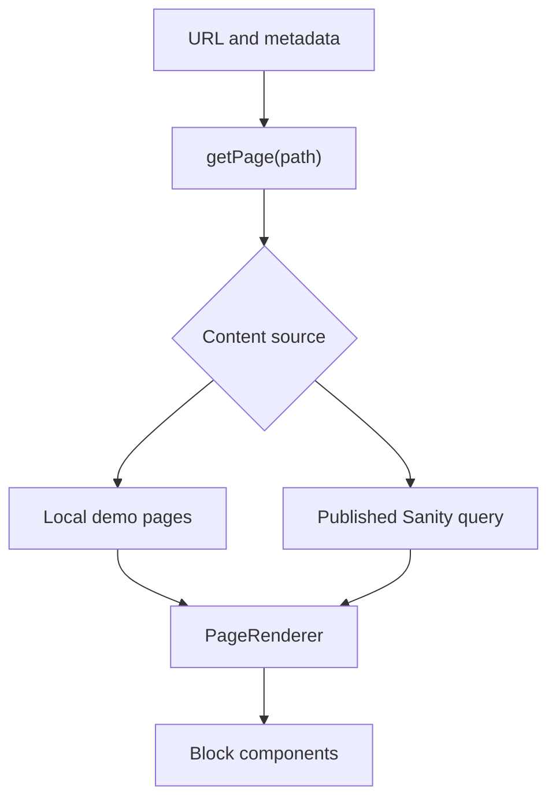

# Architecture

## The content contract

A page is a title, optional description, slug, and ordered list of blocks. Every block has a stable `_key` and a discriminating `_type`.

| Type | Content fields | Renderer |
| --- | --- | --- |
| `richText` | `content`, an array of Portable Text blocks | `PortableText` with a small link renderer |
| `imageBlock` | `url`, `alt`, optional `caption` | `next/image` inside a figure |
| `accordion` | Optional `title`, ordered `items` with heading and text | Native `details` and `summary` |

[`src/lib/types.ts`](../src/lib/types.ts) is the application's shared TypeScript contract. Demo fixtures and fetched pages both satisfy that shape, so the renderer does not need to know which source supplied them.

## Request and rendering flow

The optional catch-all route at `src/app/[[...slug]]/page.tsx` covers both `/` and nested paths. It awaits the route parameters, joins segments with `/`, and passes an empty string for the homepage. A missing page calls Next.js `notFound()`.

`generateMetadata()` calls the same `getPage()` function. React `cache()` deduplicates matching loader calls during a server render; this is separate from a persistent content cache.

The loader selects its source with `NEXT_PUBLIC_CONTENT_SOURCE`. An absent value means `demo`; other supported mode is `sanity`. Invalid configuration fails explicitly. Demo mode reads a small in-memory fixture array. Sanity mode maps the empty homepage path to the CMS slug `home`.

The Sanity client has no token, uses the `published` perspective, disables CDN reads, and fetches with `cache: 'no-store'`. The GROQ query also excludes draft IDs and uses a `$slug` parameter instead of concatenating user input. Its projection selects the page fields and supported blocks; image asset references become URLs before rendering.

`PageRenderer` renders a common heading, then dispatches on each block's `_type`. `_key` provides React identity when blocks are reordered. The source-derived accordion keeps its native HTML interaction and its own CSS module. The route, page contract, query, and other block paths are reduced adaptations of the larger template.

## File map

| File | Responsibility |
| --- | --- |
| `src/app/layout.tsx` | Shared HTML document, navigation, footer, and global CSS import |
| `src/app/[[...slug]]/page.tsx` | URL lookup, metadata, page rendering, and missing-page behavior |
| `src/app/not-found.tsx` | User-facing 404 content |
| `src/app/globals.css` | Layout, typography, colors, and shared block presentation |
| `src/lib/types.ts` | Page and block TypeScript definitions |
| `src/lib/demo-content.ts` | Fictional, self-contained local examples |
| `src/lib/content.ts` | Source selection, environment checks, published GROQ read |
| `src/components/PageRenderer.tsx` | Page output, block dispatch, rich-text link policy |
| `src/components/Accordion.tsx` | Native accordion markup |
| `src/components/Accordion.module.css` | Accordion presentation and focus styles |
| `src/app/studio/[[...tool]]/page.tsx` | Studio setup state or editor mount |
| `src/components/StudioClient.tsx` | Client boundary for the embedded Studio |
| `sanity.config.ts` | Studio configuration and schema registration |
| `src/sanity/schema.ts` | Editable Page document and its three supported block schemas |
| `public/demo-grid.svg` | Local demonstration artwork |
| `scripts/smoke.mjs` | Production-server HTTP smoke verification |

## Editing boundaries

Sanity schemas define what editors can enter. React components define how that content appears. CSS holds the visual design. The Studio is the client-side editing surface; public pages use the server-side loader.

The website exposes no mutation APIs. Studio content changes are authenticated directly by Sanity. There is no draft preview, visual editing overlay, application authentication, or private-content workflow in this edition.

The public dataset requirement is intentional. Do not interpret a field being absent from the page projection as making that field private: a public dataset remains publicly readable through Sanity.

## Add a fourth block

For a small example, add a `callout` block with a title and plain-text body:

1. In `src/lib/types.ts`, define `CalloutBlock` with `_key`, `_type: 'callout'`, `title`, and `body`, then add it to the `ContentBlock` union.
2. In `src/sanity/schema.ts`, define the object and allow it in the Page's blocks array. Register the type with the exported schema list if it is a named schema.
3. In `src/lib/content.ts`, add `callout` to the query's supported-type filter and project only its `title` and `body` fields.
4. In `src/components/PageRenderer.tsx`, add a `case 'callout'` that renders semantic markup. Keep a simple display-only block on the server.
5. Style it in `src/app/globals.css` or a dedicated CSS module.
6. Add a sample to `src/lib/demo-content.ts`. Check it in demo mode, run the verification commands, then publish a sample through your own Studio to check the CMS path.

The schema, application type, query projection, and renderer must agree. A schema change alone does not create a frontend component; a renderer alone does not make a new block available to editors.

## Deliberate tradeoffs

This edition favors a short reading path over a general-purpose component registry. A three-case switch is easy to trace. The example navigation is fixed, there is no persistent cache to invalidate, and the default content needs no external service.

The CMS response is typed rather than exhaustively validated at runtime. Sanity image URLs are rendered unoptimized with a fixed size hint, so intrinsic dimension handling and image delivery are opportunities for a production implementation. Error recovery, content previews, internationalization, and broader operational features are outside this sample's scope.
